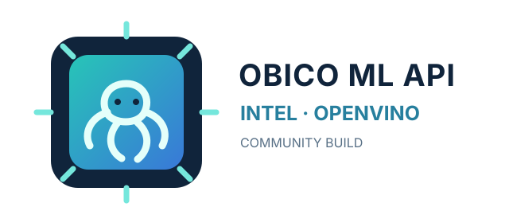

# Obico ML API — Intel OpenVINO

<p align="center">
  
</p>

An unofficial community-built Intel GPU/OpenVINO image for the Obico ML API, intended for Linux x86-64 hosts with a supported Intel graphics device.

**Image:** `ghcr.io/dafron/obico-ml-intel:latest`

> [!IMPORTANT]
> This is an independent community build. It is not affiliated with, endorsed by, or supported by Obico. Obico names are used only to identify compatibility.

## Features

- ONNX Runtime with the OpenVINO execution provider.
- Intel GPU selected by default using `ML_API_OPENVINO_DEVICE=GPU`.
- CPU execution provider available as a fallback provider.
- ONNX model fetched during image build and verified against the upstream SHA-256 checksum.
- AMD64 / `linux/amd64` image.

The host must provide a compatible Intel kernel graphics driver and expose `/dev/dri` to the container. GPU support depends on the exact Intel GPU, host kernel and driver combination. Seeing OpenVINO in the provider list alone does not prove inference is executing on the GPU; validate device initialisation and GPU utilisation.

## Pinned upstream source

This image builds the upstream Obico ML API at:

- Source: [TheSpaghettiDetective/obico-server](https://github.com/TheSpaghettiDetective/obico-server)
- Commit: `df8190ef7500459599ebf398c3d1f653754792fd`
- Dockerfile: `ml_api/Dockerfile.intel`
- Build context: `ml_api/`

The source revision is pinned in [the publishing workflow](.github/workflows/publish.yml), so upstream changes do not silently alter the image.

## Requirements

- Linux x86-64 / AMD64.
- Intel GPU supported by the host kernel driver and installed Intel userspace runtime.
- Host device nodes under `/dev/dri` (typically including `renderD128`).
- A running Obico server container.

## unRAID / Docker setup

These instructions assume the main Obico container is named `obico` and the ML API shares its network namespace.

### Main Obico container

Set this environment variable on the main Obico container:

```text
ML_API_HOST=http://localhost:3335
```

If the main Obico container has `ML_API_TOKEN` configured, set the **same value** in the ML API container. If token authentication is not in use, leave it unset.

### Intel ML API container

| Setting | Value |
|---|---|
| Image | `ghcr.io/dafron/obico-ml-intel:latest` |
| Network | Share network namespace of container `obico` |
| Device | `/dev/dri:/dev/dri` |
| `ML_API_GPU_PROVIDER` | `OpenVINOExecutionProvider` |
| `ML_API_OPENVINO_DEVICE` | `GPU` |
| `ML_API_TOKEN` | Same as main Obico container, if configured |
| Command | `gunicorn --bind 0.0.0.0:3335 --workers 1 --timeout 120 wsgi` |

Because both containers share a network namespace, do not publish a separate host port for the ML API. It listens on port 3335 inside that shared namespace.

Equivalent Docker command:

```bash
docker run -d \
  --name obico-ml-intel \
  --restart unless-stopped \
  --network container:obico \
  --device /dev/dri:/dev/dri \
  -e ML_API_GPU_PROVIDER=OpenVINOExecutionProvider \
  -e ML_API_OPENVINO_DEVICE=GPU \
  -e ML_API_TOKEN='YOUR_OBICO_ML_API_TOKEN' \
  --entrypoint gunicorn \
  ghcr.io/dafron/obico-ml-intel:latest \
  --bind 0.0.0.0:3335 --workers 1 --timeout 120 wsgi
```

If you do not use token authentication, omit the `ML_API_TOKEN` line. Replace the placeholder with the same token configured in Obico. Never publish the token in logs, screenshots or issue reports.

**unRAID note:** `--network container:obico` is essential for this arrangement. If you recreate the main Obico container, recreate the ML API container too.

### Verify the API

Run on the unRAID terminal:

```bash
docker exec obico curl -fsS http://127.0.0.1:3335/hc/
```

Expected response:

```text
ok
```

Inspect startup logs:

```bash
docker logs --tail 200 obico-ml-intel
```

Check the ONNX Runtime provider output and OpenVINO/device initialisation messages. A successful health check confirms the API responds; it does not establish that GPU inference is active.

## Updating

Pull the latest published image and recreate the ML API container:

```bash
docker pull ghcr.io/dafron/obico-ml-intel:latest
```

The `latest` tag is built from the pinned source revision when this repository's `main` branch is updated. The workflow also publishes commit-SHA tags and version tags when a `v*` Git tag is pushed.

## Build and package visibility

GitHub Actions builds the AMD64 image and publishes it to GHCR on pushes to `main`, version tags (`v*`) and manual workflow runs. It uses the repository's built-in `GITHUB_TOKEN`; no personal access token is stored here.

GitHub may create the GHCR package as private initially. If the first image is not publicly pullable, open the package settings for `obico-ml-intel` on GitHub and change package visibility to **Public**.

## Troubleshooting

- **No `/dev/dri`:** Check that the Intel graphics device is enabled and exposed by unRAID.
- **Device permission errors:** Check host device nodes and container access to the render device.
- **OpenVINO provider missing:** Check image build and container startup logs.
- **GPU initialisation fails:** Check compatibility between the Intel GPU, host kernel driver and installed Level Zero/OpenCL runtime.
- **Health check works but detection is slow:** Health is only an API response check. Check provider/device initialisation and GPU utilisation during inference.

## Licence and notices

The upstream Obico server source is licensed under the GNU Affero General Public License, version 3 (AGPL-3.0). The upstream licence text is included in [LICENSE](LICENSE). Upstream copyright notices remain applicable to the upstream source and derived image. This repository's workflow, logo and documentation are separate project materials.
